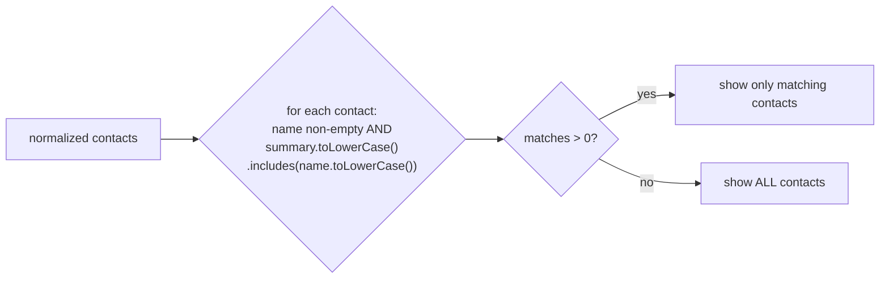

# API & Data Contract

← [Back to docs index](./README.md)

This page is the contract between the frontend and the backend: what the UI sends, what it expects back, and exactly how it interprets the response. Source: `src/api/contactApi.ts`.

- [1. Endpoints](#1-endpoints)
- [2. Normalization rules](#2-normalization-rules)
- [3. Summary-based filtering](#3-summary-based-filtering)
- [4. Client functions reference](#4-client-functions-reference)
- [5. Backend checklist](#5-backend-checklist)

---

## 1. Endpoints

**Base URL:** `http://localhost:8000` (hard-coded in `axios.create({ baseURL })`)
**Content type:** JSON (Axios default `application/json`)
**Auth:** none
**Timeout:** none configured

| Method | Path | Client function | Used by UI today? |
|---|---|---|---|
| `POST` | `/search` | `searchContacts(query)` | ✅ yes (`Home`) |
| `GET` | `/contacts/:contactId` | `getContact(contactId)` | ❌ not yet (available for a future detail view) |
| `GET` | `/contacts/count` | `getContactCount()` | ❌ not yet |

### 1.1 `POST /search`

Runs a natural-language search.

**Request**

```http
POST /search HTTP/1.1
Host: localhost:8000
Content-Type: application/json

{ "query": "Find frontend developers in San Francisco" }
```

| Field | Type | Notes |
|---|---|---|
| `query` | string | Already trimmed by the UI and never empty. |

**Response (plain JSON)**

```json
{
  "response": "Avery Johnson is a frontend engineer based in San Francisco.",
  "contacts": [
    {
      "contactId": "contact-1",
      "name": "Avery Johnson",
      "title": "Frontend Engineer",
      "location": "San Francisco",
      "skills": ["React", "TypeScript", "CSS"]
    }
  ]
}
```

**Response (DynamoDB attribute-value JSON), also accepted**

```json
{
  "response": "Avery Johnson is a frontend engineer based in San Francisco.",
  "contacts": [
    {
      "contactId": { "S": "contact-1" },
      "name":      { "S": "Avery Johnson" },
      "title":     { "S": "Frontend Engineer" },
      "location":  { "S": "San Francisco" },
      "skills":    { "L": [ { "S": "React" }, { "S": "TypeScript" } ] }
    }
  ]
}
```

Plain and DynamoDB-style fields can be **mixed**, even within one contact.

| Field | Accepted types | If missing or invalid |
|---|---|---|
| `response` | `string` or `{ "S": string }` | `""`, and the summary section is hidden |
| `contacts` | array | `[]`, and "No contacts matched" is shown |
| `contacts[].contactId` | `string` or `{S}` | `""` |
| `contacts[].name` | `string` or `{S}` | `""` |
| `contacts[].title` | `string` or `{S}` | `""` |
| `contacts[].location` | `string` or `{S}` | `""` |
| `contacts[].skills` | `string[]`, `{S}[]`, or `{ "L": [...] }` | `[]` |

Any extra fields are ignored.

**Errors:** any non-2xx status or network failure shows **"Search failed"** in the UI. The response body of an error is not read.

### 1.2 `GET /contacts/:contactId`

Fetches one contact. The response body is a single contact object, plain or DynamoDB-style, and goes through `normalizeContact`.

```http
GET /contacts/contact-1
```

> `contactId` is inserted into the URL as-is (not URL-encoded). IDs containing `/`, `?`, `#`, or spaces would break the request. Use `encodeURIComponent` if such IDs are possible.

### 1.3 `GET /contacts/count`

Returns whatever the backend sends (`response.data`) **without normalization**, typed as `any`. The exact shape is defined by the backend.

---

## 2. Normalization rules

Normalization lets the rest of the app trust that every `Contact` field is a real string and every `skills` entry is a non-empty string.

### `readString(value) → string`

| Input | Output |
|---|---|
| `"Avery"` | `"Avery"` |
| `{ "S": "Avery" }` | `"Avery"` |
| `{ "S": 42 }` | `""` |
| `{ "N": "42" }` | `""` (numbers are **not** supported) |
| `null`, `undefined`, `42`, `true` | `""` |

### `readStringList(value) → string[]`

| Input | Output |
|---|---|
| `["React", "", "CSS"]` | `["React", "CSS"]` (empty strings removed) |
| `[{ "S": "React" }, "CSS"]` | `["React", "CSS"]` |
| `{ "L": [{ "S": "React" }, { "S": "Go" }] }` | `["React", "Go"]` |
| `{ "SS": ["React"] }` | `[]` (DynamoDB **string sets are not supported**) |
| `"React"`, `null`, `{}` | `[]` |

### `normalizeContact(raw) → Contact`

Applies `readString` to `contactId`, `name`, `title`, `location` and `readStringList` to `skills`. It never throws.

---

## 3. Summary-based filtering

After normalization, `filterContactsMentionedInSummary(contacts, summary)` decides **which** contacts to display.



**Why:** the backend may return a broad candidate list while the AI summary talks about only a few people. Filtering keeps the cards consistent with the summary.

**Examples** (contacts: *Avery Johnson*, *Sam Lee*, *Priya Patel*)

| Summary | Displayed |
|---|---|
| "Avery Johnson and Priya Patel are frontend engineers in SF." | Avery Johnson, Priya Patel |
| "I found 3 frontend engineers in San Francisco." | all three (no names mentioned) |
| "Avery is the best match." | all three (only the **full** name counts, so "Avery" alone doesn't match) |
| "AVERY JOHNSON leads the team." | Avery Johnson (case-insensitive) |

**Caveats**
- This is plain substring matching. A contact named "Sam Lee" would also match a summary containing "Sam Leeds".
- The count badge ("N results") shows the count **after** filtering.

---

## 4. Client functions reference

```ts
// src/api/contactApi.ts
export const searchContacts: (query: string) => Promise<SearchResponse>;
export const getContact:     (contactId: string) => Promise<Contact>;
export const getContactCount: () => Promise<any>;
```

| Function | Throws when | Returns |
|---|---|---|
| `searchContacts` | network error or non-2xx (`AxiosError`) | normalized and filtered `SearchResponse` |
| `getContact` | network error or non-2xx | normalized `Contact` |
| `getContactCount` | network error or non-2xx | raw `response.data` |

The internal helpers (`readString`, `readStringList`, `normalizeContact`, `normalizeSearchResponse`, `filterContactsMentionedInSummary`) are **not exported**. To unit-test them, export them or move them to a separate `normalize.ts` module.

---

## 5. Backend checklist

For the UI to work against a backend, the backend must:

- [ ] Listen on `http://localhost:8000`, or update the base URL in the frontend.
- [ ] Allow **CORS** from the UI origin (`http://localhost:5173` in dev, `http://localhost:4173` for `npm run preview`, plus your production domain). It must accept `POST` with `Content-Type: application/json`, which triggers a preflight `OPTIONS` request.
- [ ] Implement `POST /search` and return `{ response, contacts }` with a 2xx status.
- [ ] Return a unique, non-empty `contactId` for every contact. React uses it as the list key.
- [ ] Use full contact names in the summary if it should narrow the displayed cards (see §3).
- [ ] Return strings or `{S}` / `{L}` wrappers only. Numbers (`{N}`), string sets (`{SS}`), and maps (`{M}`) are dropped.
