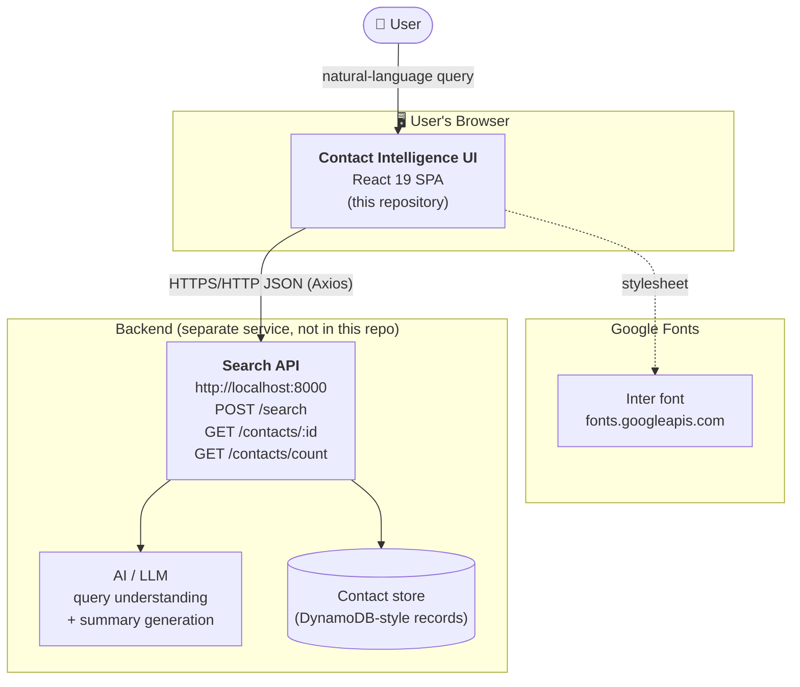
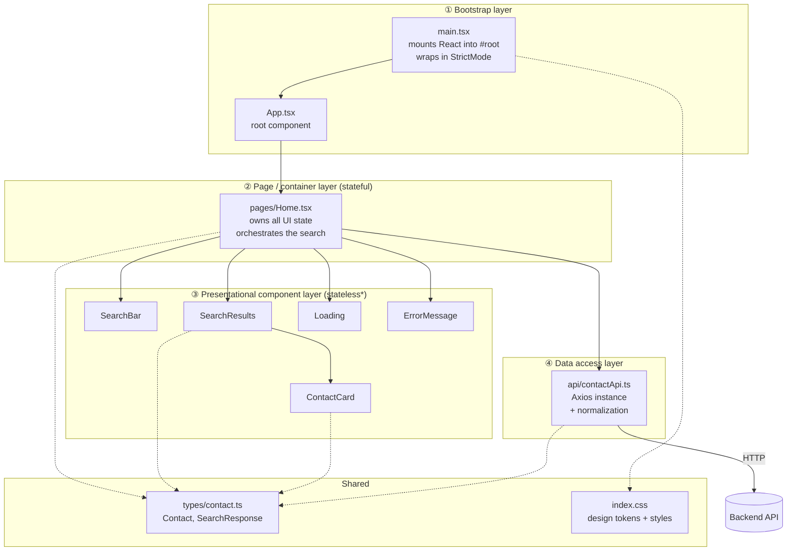
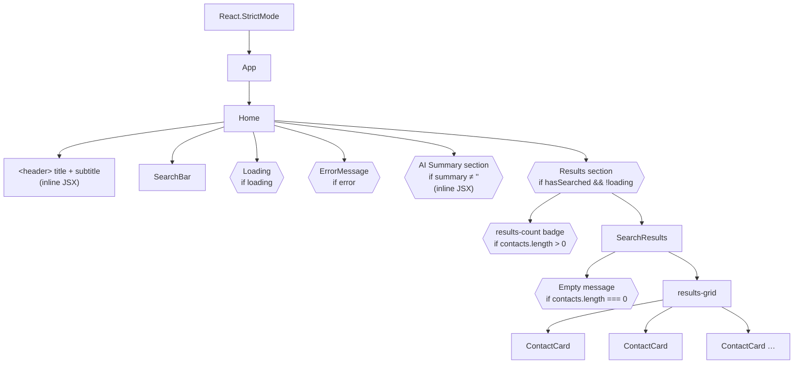
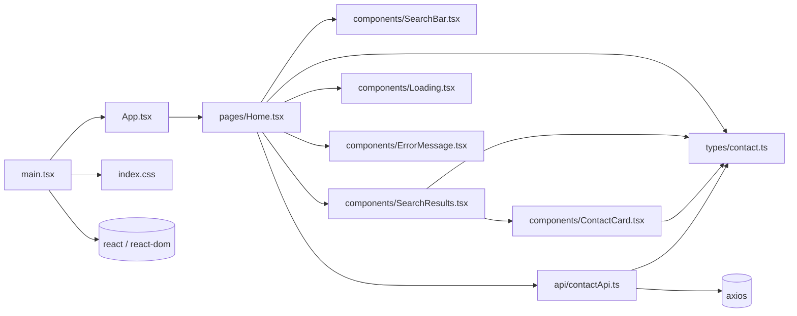
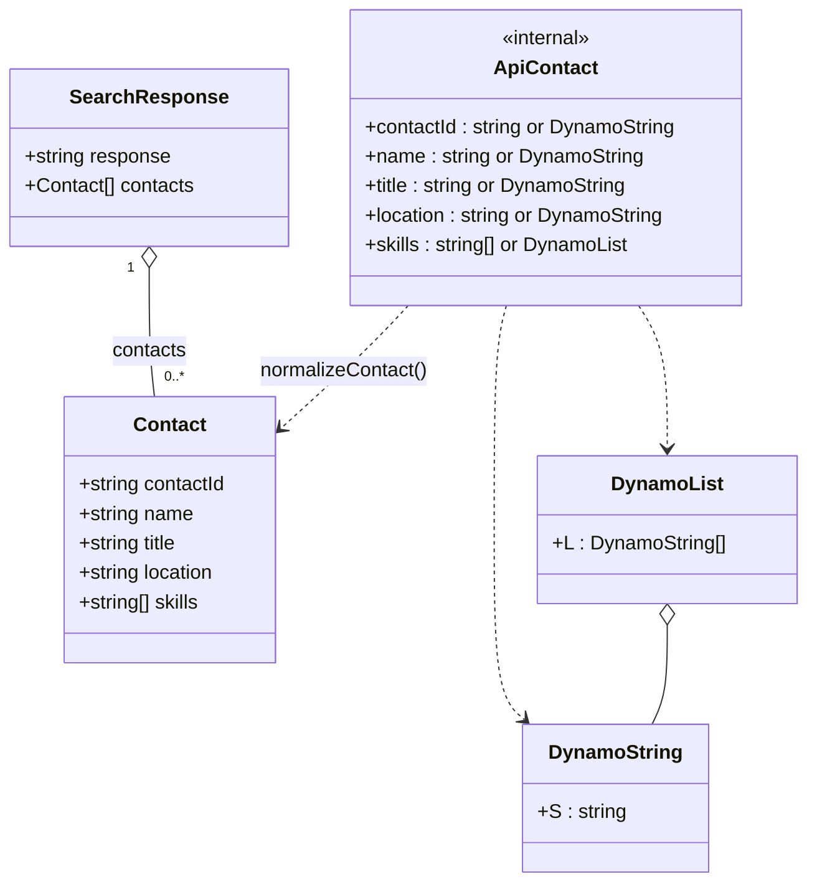
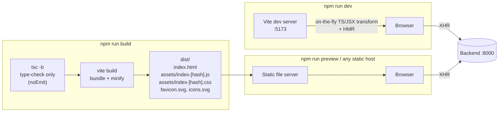

# Architecture & High-Level Design

← [Back to docs index](./README.md)

This page describes how the system is put together, from the widest view (where the app sits among other systems) down to individual modules.

- [1. System context](#1-system-context)
- [2. High-level architecture (layers)](#2-high-level-architecture-layers)
- [3. Component architecture](#3-component-architecture)
- [4. Module dependency graph](#4-module-dependency-graph)
- [5. State management](#5-state-management)
- [6. Data model](#6-data-model)
- [7. Build & runtime architecture](#7-build--runtime-architecture)
- [8. Design decisions & rationale](#8-design-decisions--rationale)
- [9. Non-functional characteristics](#9-non-functional-characteristics)

---

## 1. System context

The frontend is one piece of a larger system. It talks to exactly **one** backend service over HTTP. Everything "intelligent" (understanding the query, finding contacts, writing the summary) happens behind that API.

> The boxes inside **Backend** are inferred from the API contract (an AI summary plus DynamoDB-shaped values). Check the backend repository for its actual internals.

---

## 2. High-level architecture (layers)

The code is organized into four thin layers. Each layer depends only on the layers below it.

\* `SearchBar` keeps one piece of local state, the text the user is typing. It owns no application data.

| Layer | Responsibility | Files |
|---|---|---|
| **Bootstrap** | Start React, load global CSS, render the root | `src/main.tsx`, `src/App.tsx`, `index.html` |
| **Page / container** | Hold application state, call the API, decide what to render | `src/pages/Home.tsx` |
| **Presentational** | Render UI from props and emit user events. No API calls. | `src/components/*.tsx` |
| **Data access** | Talk HTTP and turn raw backend JSON into typed, clean objects | `src/api/contactApi.ts` |
| **Shared** | Types and styling used across layers | `src/types/contact.ts`, `src/index.css` |

This is the **container/presentational** pattern. `Home` is the only "smart" component. Everything else is "dumb" and easy to reuse or test in isolation.

---

## 3. Component architecture

### 3.1 Component tree

Hexagons are **conditionally rendered**.

### 3.2 Component reference

| Component | File | Props | Local state | Renders | Accessibility |
|---|---|---|---|---|---|
| `App` | `src/App.tsx` | — | — | `<Home />` | — |
| `Home` | `src/pages/Home.tsx` | — | `contacts`, `summary`, `loading`, `error`, `hasSearched` | Header, search bar, status, summary, results | Semantic `<header>`, `<section>`, `<h1>/<h2>` |
| `SearchBar` | `src/components/SearchBar.tsx` | `onSearch(query: string)`, `disabled?: boolean` (default `false`) | `query` | `<form>` with input and submit button | Native form. Pressing Enter submits. |
| `SearchResults` | `src/components/SearchResults.tsx` | `contacts: Contact[]` | — | Empty-state text **or** a grid of `ContactCard` | — |
| `ContactCard` | `src/components/ContactCard.tsx` | `contact: Contact` | — | Avatar initials, name, title, location, skill chips | `<article>`; avatar is `aria-hidden` |
| `Loading` | `src/components/Loading.tsx` | — | — | Spinner plus "Searching contacts..." | `role="status"`, `aria-live="polite"` |
| `ErrorMessage` | `src/components/ErrorMessage.tsx` | `message: string` | — | Red alert box | `role="alert"` |

### 3.3 Component behaviour details

**SearchBar**
- Trims the input before submitting. Whitespace-only input is never sent.
- The **Search** button is disabled when `disabled` is true *or* the trimmed query is empty.
- The input is also disabled while a search is running, which prevents overlapping requests.
- Submitting calls `e.preventDefault()`, so the page never reloads.

**ContactCard: `getInitials(name)`**
- Splits the name on spaces, takes the first **two** words, takes the first letter of each, and upper-cases the result.
- `"avery johnson"` → `AJ`; `"Prince"` → `P`; `"Mary Ann Lee"` → `MA`.

**SearchResults**
- Uses `contactId` as the React `key` for each card.

---

## 4. Module dependency graph

The actual `import` relationships in `src/`:

There are no circular dependencies. `types/contact.ts` is a leaf with no imports, and only type-level imports (`import type`) point to it, so it adds nothing to the JavaScript bundle.

---

## 5. State management

There is no global store (no Redux, Zustand, or Context). All application state lives in `Home` as five `useState` hooks.

| State | Type | Initial | Meaning |
|---|---|---|---|
| `contacts` | `Contact[]` | `[]` | Contacts to display (already normalized and filtered) |
| `summary` | `string` | `""` | AI summary text. The summary section renders only when this is non-empty. |
| `loading` | `boolean` | `false` | A request is in flight. Disables the search bar and shows the spinner. |
| `error` | `string` | `""` | User-facing error text. Shows the red alert when non-empty. |
| `hasSearched` | `boolean` | `false` | Becomes `true` on the first search. Before that, the results section stays hidden (no "No contacts matched" message on first load). |

### Render rules (derived UI)

| Condition | UI element shown |
|---|---|
| always | Header + SearchBar |
| `loading` | `<Loading />` |
| `error !== ""` | `<ErrorMessage />` |
| `summary !== ""` | AI Summary card |
| `hasSearched && !loading` | "Contacts" heading + `<SearchResults />` |
| …and `contacts.length > 0` | "N result(s)" badge |

The full state machine is in [FLOWS.md › UI state machine](./FLOWS.md#3-ui-state-machine).

---

## 6. Data model

- **Public types** (`src/types/contact.ts`): `Contact` and `SearchResponse`. Every field is required and always a string or string array, so components never need null checks.
- **Internal types** (`src/api/contactApi.ts`): `ApiContact`, `DynamoString`, `DynamoList`. These describe the loose shape that *might* come from the backend and never leave the API module.

---

## 7. Build & runtime architecture

- **TypeScript config** uses project references. `tsconfig.json` points at `tsconfig.app.json` (browser code in `src/`) and `tsconfig.node.json` (`vite.config.ts`). Both use `noEmit`, so TypeScript only type-checks and Vite does the transpiling.
- **Notable compiler flags:** `noUnusedLocals`, `noUnusedParameters`, `erasableSyntaxOnly` (no `enum`/`namespace`, which keeps TS strippable), `verbatimModuleSyntax` (requires `import type` for type-only imports).
- **Output** is static files with no server-side rendering, so it can be hosted on S3/CloudFront, Netlify, Vercel, Nginx, or similar.

---

## 8. Design decisions & rationale

| # | Decision | Why | Trade-off |
|---|---|---|---|
| D1 | **Single page, no router** | The product has one job, search, and routing would add weight without value. | Adding a contact-detail page later will need `react-router` or similar. |
| D2 | **State in `Home` with `useState`** | Five small, related values. A store would be overkill. | If more pages need the same data, lift it into Context or a query library (e.g. TanStack Query). |
| D3 | **Container/presentational split** | Components stay pure and reusable, and API logic is isolated. | Some prop-passing. Negligible at this size. |
| D4 | **Normalize at the API boundary** | The backend may return DynamoDB-typed values. Converting once in `contactApi.ts` means the rest of the app only sees clean types. | Normalization silently turns bad data into `""`/`[]` instead of failing loudly. |
| D5 | **Filter contacts by summary mentions** | Keeps the cards consistent with what the AI summary says. | A heuristic (exact full-name substring). See [API.md §3](./API.md#3-summary-based-filtering). |
| D6 | **Axios instance with `baseURL`** | One place to configure the backend URL, and later headers, auth, or timeouts. | The URL is currently hard-coded (see [Development Guide › Configuration](./DEVELOPMENT.md#5-configuration)). |
| D7 | **Plain CSS + design tokens** | Zero runtime cost, no extra tooling, easy theming through `:root` variables. | No scoping. BEM-style naming (`block__element--modifier`) prevents collisions. |
| D8 | **Disable input while loading** | Prevents concurrent requests and out-of-order responses without extra code. | The user cannot cancel or replace a slow search. |

---

## 9. Non-functional characteristics

| Attribute | Current state |
|---|---|
| **Performance** | Tiny bundle (React + Axios + about 300 lines of app code). One HTTP call per search. No pagination, so very large result sets would all render at once. |
| **Responsiveness** | Fluid grid (`.results-grid`). Under 600px the search bar stacks vertically and the grid becomes one column. |
| **Accessibility** | Semantic HTML; `role="status"` + `aria-live` for loading; `role="alert"` for errors; decorative avatar hidden from screen readers. The input has no `<label>` (placeholder only), which is a possible improvement. |
| **Security** | No auth and no secrets in the client. React escapes all rendered text, which protects against XSS from summary/contact data. The backend must allow CORS from the UI origin. |
| **Reliability** | Any failed request shows a generic "Search failed". No retries and no request timeout. |
| **Testability** | Presentational components and the pure normalization functions are easy to unit-test. No test suite exists yet. |
| **Observability** | None in the client (no logging or analytics). Use the browser DevTools Network tab. |
