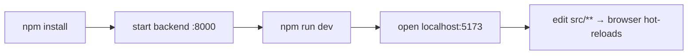
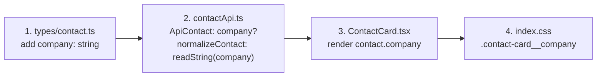
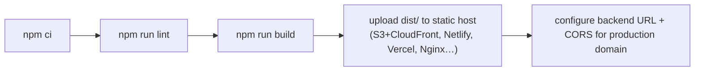

# Development Guide

← [Back to docs index](./README.md)

Everything you need to run, change, and ship the frontend.

- [1. Prerequisites](#1-prerequisites)
- [2. Setup & running](#2-setup--running)
- [3. Scripts](#3-scripts)
- [4. Project structure](#4-project-structure)
- [5. Configuration](#5-configuration)
- [6. Coding conventions](#6-coding-conventions)
- [7. Styling system](#7-styling-system)
- [8. How to extend the app](#8-how-to-extend-the-app)
- [9. Known limitations & improvement ideas](#9-known-limitations--improvement-ideas)
- [10. Troubleshooting](#10-troubleshooting)
- [11. Deployment](#11-deployment)

---

## 1. Prerequisites

| Tool | Version |
|---|---|
| Node.js | 20+ (Vite 8 requires a modern Node; use the current LTS) |
| npm | the version bundled with Node |
| Backend search API | running on `http://localhost:8000` (see [API.md](./API.md)) |

## 2. Setup & running

```bash
git clone <your-repository-url>
cd contact-intelligence-ui
npm install          # installs exact versions from package-lock.json
npm run dev          # starts Vite on http://localhost:5173
```

Open the URL Vite prints and try a query such as *"Find frontend developers in San Francisco"*.



## 3. Scripts

| Command | What it does |
|---|---|
| `npm run dev` | Vite dev server with Hot Module Replacement (HMR) |
| `npm run build` | `tsc -b` (type-check, fails on type errors) **then** `vite build` → `dist/` |
| `npm run preview` | Serves `dist/` locally (default `http://localhost:4173`) |
| `npm run lint` | ESLint over all `.ts`/`.tsx` files (ignores `dist/`) |

No test script exists yet. See [§9](#9-known-limitations--improvement-ideas).

## 4. Project structure

```text
contact-intelligence-ui/
├── docs/                       # ← you are here
├── index.html                  # HTML shell: #root div, Inter font, favicon, <title>
├── public/                     # copied verbatim to dist/ and served at /
│   ├── favicon.svg             # browser tab icon
│   └── icons.svg               # (currently unused)
├── src/
│   ├── main.tsx                # entry: createRoot + StrictMode + global CSS
│   ├── App.tsx                 # root component → <Home/>
│   ├── index.css               # design tokens + all component styles
│   ├── pages/
│   │   └── Home.tsx            # the only page; owns state & calls the API
│   ├── components/
│   │   ├── SearchBar.tsx       # controlled input + submit button
│   │   ├── SearchResults.tsx   # empty state or grid of cards
│   │   ├── ContactCard.tsx     # one contact: initials, title, location, skills
│   │   ├── Loading.tsx         # spinner + "Searching contacts..."
│   │   └── ErrorMessage.tsx    # red alert box
│   ├── api/
│   │   └── contactApi.ts       # Axios client + response normalization
│   ├── types/
│   │   └── contact.ts          # Contact, SearchResponse interfaces
│   └── assets/                 # hero.png, react.svg, vite.svg (Vite template leftovers, unused)
├── eslint.config.js            # flat ESLint config
├── tsconfig.json               # project references → app + node
├── tsconfig.app.json           # TS settings for src/
├── tsconfig.node.json          # TS settings for vite.config.ts
├── vite.config.ts              # Vite + React plugin
└── package.json / package-lock.json
```

## 5. Configuration

### Backend URL

The base URL is **hard-coded** in `src/api/contactApi.ts`:

```ts
const api = axios.create({ baseURL: "http://localhost:8000" });
```

**Recommended change** so each environment can point at its own backend:

```ts
const api = axios.create({
  baseURL: import.meta.env.VITE_API_BASE_URL ?? "http://localhost:8000",
});
```

```bash
# .env.local  (git-ignored)
VITE_API_BASE_URL=http://localhost:8000
```

> Only variables prefixed with `VITE_` are exposed to the browser. Anything in them is **public** once built, so never put secrets there.

`.gitignore` excludes `.env` and `.env.*` but keeps `.env.example`, so you can commit an example file.

### Alternative: dev proxy (avoids CORS in development)

```ts
// vite.config.ts
export default defineConfig({
  plugins: [react()],
  server: { proxy: { "/api": { target: "http://localhost:8000", rewrite: p => p.replace(/^\/api/, "") } } },
});
// then baseURL: "/api"
```

## 6. Coding conventions

| Area | Convention in this codebase |
|---|---|
| Components | Function components, **default export**, one per file, PascalCase file name |
| Props | Declared as a local `interface Props` above the component |
| Types | Shared types in `src/types/`; use `import type { … }` (required by `verbatimModuleSyntax`) |
| API access | **Only** through `src/api/*`. Components never import Axios directly. |
| State | Keep it in the page (`Home`) and pass it down via props. Children report events through callbacks (`onSearch`). |
| CSS classes | BEM-style: `block`, `block__element`, `block--modifier` (e.g. `contact-card__skill`, `status-message--error`) |
| Unused code | `noUnusedLocals` / `noUnusedParameters` make the build fail. Delete dead code instead of leaving it. |
| TS syntax | `erasableSyntaxOnly`: no `enum`, `namespace`, or parameter properties. Use union types and objects instead. |
| Lint | `react-hooks` rules (hooks at top level, exhaustive deps) and `react-refresh` (files export components only, so HMR works) |

## 7. Styling system

All styles live in `src/index.css`. Colors, shadows, radii, and font are **design tokens** on `:root`:

| Token group | Tokens |
|---|---|
| Surfaces | `--color-bg` `#f1f5f9`, `--color-surface` `#fff`, `--color-border` `#e2e8f0` |
| Text | `--color-text` `#0f172a`, `--color-text-muted` `#64748b` |
| Brand | `--color-primary` `#2563eb`, `--color-primary-hover` `#1d4ed8`, `--color-primary-soft` `#eff6ff` |
| Error | `--color-error-bg`, `--color-error-border`, `--color-error-text` |
| Skill chips | `--color-skill-bg` `#eef2ff`, `--color-skill-text` `#4338ca` |
| Elevation | `--shadow-sm`, `--shadow-md`, `--shadow-lg` |
| Shape | `--radius-sm` 8px, `--radius-md` 12px, `--radius-lg` 16px |
| Type | `--font-sans` (Inter → system fallbacks) |

**Responsive:** one breakpoint at `max-width: 600px`. Below it the search bar stacks, the button goes full-width, and the results grid becomes a single column.

**To re-theme**, change the token values. To add dark mode, redefine the tokens inside `@media (prefers-color-scheme: dark) { :root { … } }`.

## 8. How to extend the app

### Add a new field to contacts (e.g. `company`)



### Add a new API call

1. Add a function in `src/api/contactApi.ts` that uses the shared `api` instance.
2. Normalize the response at that boundary and return a type from `src/types/`.
3. Call it from a page component. Keep components presentational.

### Add a contact detail page

1. `npm i react-router-dom`, then define routes in `App.tsx` (`/` → `Home`, `/contacts/:id` → `ContactDetail`).
2. Make `ContactCard` a link to `/contacts/${encodeURIComponent(contactId)}`.
3. In `ContactDetail`, call the existing `getContact(id)`.

### Add tests (recommended setup)

```bash
npm i -D vitest @testing-library/react @testing-library/jest-dom jsdom
```

Good first tests:
- `readString` / `readStringList` / `filterContactsMentionedInSummary` (pure functions; export them first)
- `SearchBar` doesn't submit empty or whitespace-only input
- `Home` shows the error alert when `searchContacts` rejects (mock the module)

## 9. Known limitations & improvement ideas

| # | Area | Current behaviour | Suggested improvement |
|---|---|---|---|
| 1 | Stale data on error | When a search fails, the previous summary and cards stay on screen **below** the "Search failed" alert, so they look like the answer to the new query. | In `handleSearch`, clear `contacts` and `summary` at the start of each search (or in `catch`). |
| 2 | Stale summary while loading | The previous AI summary stays visible while a new search runs. | Same fix as #1, or hide the summary while `loading`. |
| 3 | Generic error | Every failure shows "Search failed" and the error is discarded. | Tell the user whether it was a network error or a server error, and `console.error` the cause. |
| 4 | Hard-coded API URL | `http://localhost:8000` is baked into the bundle. | Use `VITE_API_BASE_URL` ([§5](#5-configuration)). |
| 5 | No timeout / cancel | A hanging backend leaves the spinner running indefinitely, and the input stays disabled. | Set an Axios `timeout`, and/or use an `AbortController` with a Cancel button. |
| 6 | Name-match filter heuristic | Exact full-name substring. Partial names don't match, and substrings can over-match. | Have the backend return the IDs of the contacts it referenced, and filter by ID. |
| 7 | React keys | Cards use `contactId` and skill chips use the skill text as keys. Missing IDs or duplicate skills cause duplicate-key warnings. | Fall back to the index, or de-duplicate skills during normalization. |
| 8 | Unencoded path param | `getContact` doesn't URL-encode `contactId`. | `encodeURIComponent(contactId)`. |
| 9 | Unused code/assets | `getContact`, `getContactCount`, `src/assets/*`, `public/icons.svg` are unused. | Use them or remove them. |
| 10 | Input label | The search input has only a placeholder, with no accessible label. | Add `aria-label="Search contacts"` or a visually hidden `<label>`. |
| 11 | No tests / CI | — | Vitest + Testing Library, plus a CI job running `lint` and `build`. |
| 12 | No pagination | All returned contacts render at once. | Paginate or virtualize if result sets grow large. |
| 13 | Dynamo types | Only `{S}` and `{L}` are understood. | Support `{N}`, `{SS}`, `{M}` if the backend ever returns them, or have the backend unmarshal. |

## 10. Troubleshooting

| Symptom | Likely cause | Fix |
|---|---|---|
| "Search failed" every time | Backend not running or on a different port | Start the backend on `:8000` and check `curl -X POST localhost:8000/search -H 'Content-Type: application/json' -d '{"query":"test"}'` |
| "Search failed"; console shows a **CORS** error | Backend doesn't allow the UI origin | Enable CORS for `http://localhost:5173` on the backend, or use the [Vite proxy](#alternative-dev-proxy-avoids-cors-in-development) |
| Summary shows but no cards / unexpected cards | Contacts filtered by name mentions, or wrong field types | See [API.md §3](./API.md#3-summary-based-filtering); inspect the response in DevTools → Network |
| Cards with blank names or titles | Backend sends unsupported types (e.g. numbers, `{N}`) | Return strings or `{S}` |
| `npm run build` fails on "declared but never used" | `noUnusedLocals` / `noUnusedParameters` | Remove the unused variable or import |
| Build error about `import type` | `verbatimModuleSyntax` | Change `import { Contact }` to `import type { Contact }` |
| Odd dependency errors | Corrupt `node_modules` | `rm -rf node_modules && npm install` |

## 11. Deployment



- The output is purely static. Any static host works.
- No client-side routes exist yet, so no SPA fallback rewrite is needed. If you add a router, configure the host to serve `index.html` for unknown paths.
- Make sure the production build points at the production backend (see [§5](#5-configuration)) and that the backend's CORS settings include the production origin.
