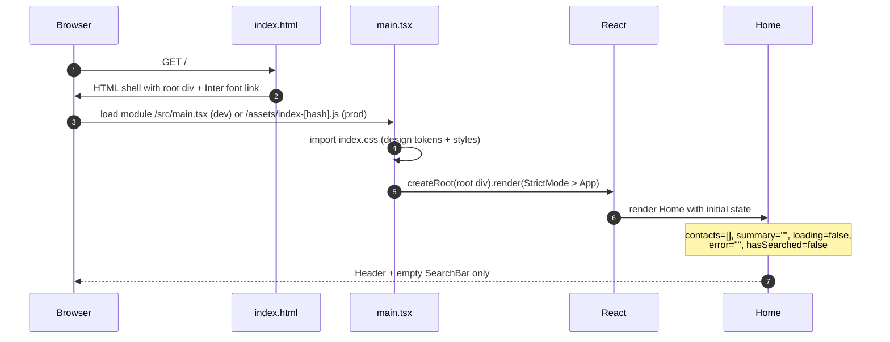
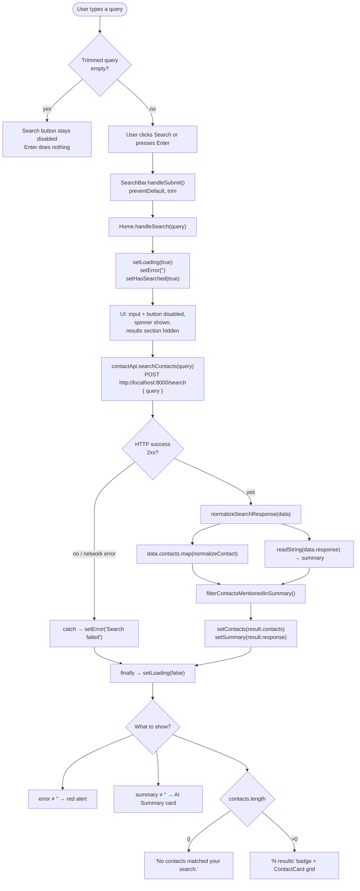
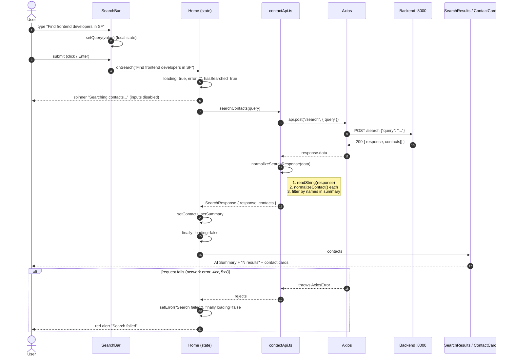
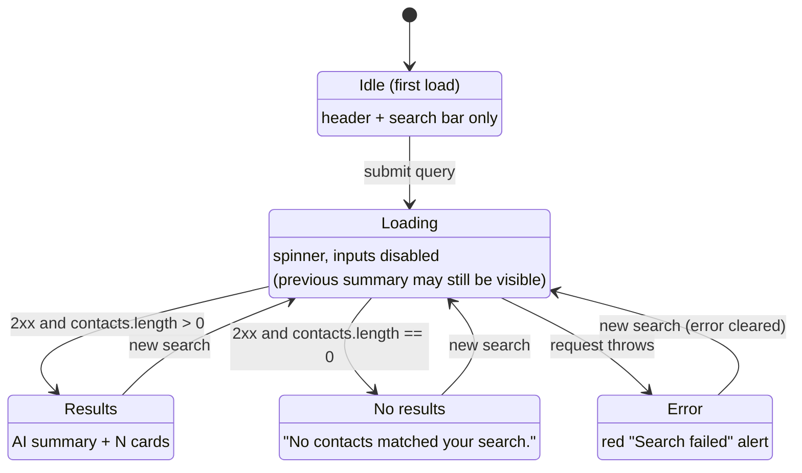
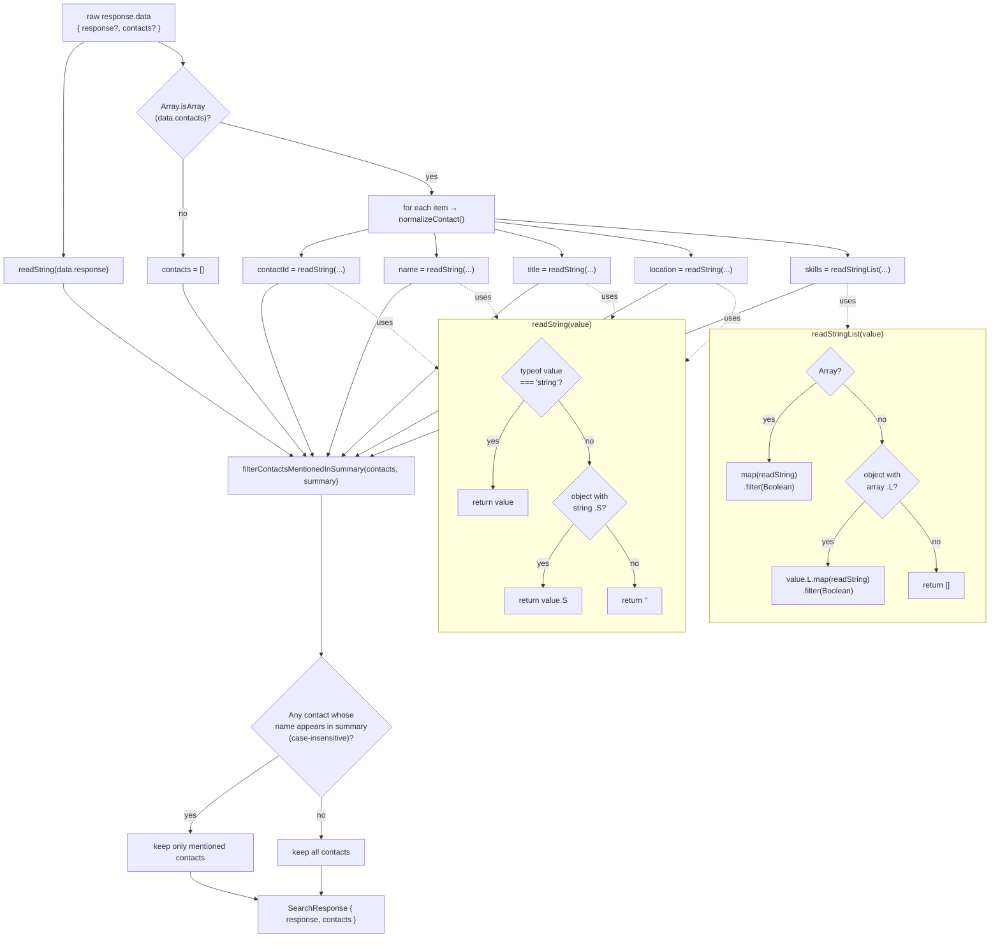
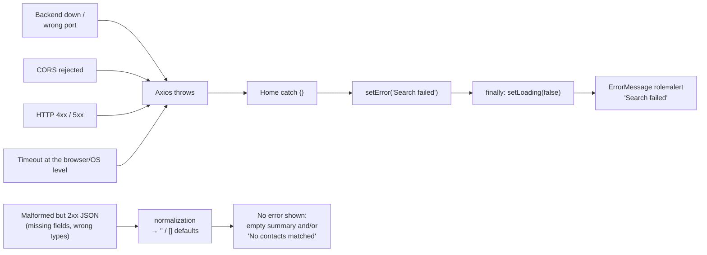

# Flows

← [Back to docs index](./README.md)

This page walks through what happens, step by step, when someone uses the app.

- [1. Application startup flow](#1-application-startup-flow)
- [2. Search flow (end-to-end)](#2-search-flow-end-to-end)
  - [2.1 Flowchart](#21-flowchart)
  - [2.2 Sequence diagram](#22-sequence-diagram)
- [3. UI state machine](#3-ui-state-machine)
- [4. Response normalization flow](#4-response-normalization-flow)
- [5. Error flow](#5-error-flow)
- [6. Screen-by-screen walkthrough](#6-screen-by-screen-walkthrough)

---

## 1. Application startup flow



No network call to the backend happens at startup. The first API request is made when the user submits a search.

> In development, `React.StrictMode` intentionally double-invokes renders to surface side-effect bugs. This is normal and does not happen in production builds.

---

## 2. Search flow (end-to-end)

### 2.1 Flowchart



### 2.2 Sequence diagram



---

## 3. UI state machine

The five `useState` values in `Home` combine into a small set of visible states:



| Visible state | `loading` | `error` | `hasSearched` | `contacts` | `summary` |
|---|---|---|---|---|---|
| Idle | `false` | `""` | `false` | `[]` | `""` |
| Loading | `true` | `""` | `true` | *(previous)* | *(previous)* |
| Results | `false` | `""` | `true` | non-empty | usually non-empty |
| No results | `false` | `""` | `true` | `[]` | any |
| Error | `false` | `"Search failed"` | `true` | *(previous)* | *(previous)* |

> ⚠️ `contacts` and `summary` are **not cleared** when a new search starts or fails. While loading, the *previous* AI summary stays visible. After a failure, the error alert appears **together with the previous search's summary and cards**. See [Known limitations](./DEVELOPMENT.md#9-known-limitations--improvement-ideas).

---

## 4. Response normalization flow

`normalizeSearchResponse` in `src/api/contactApi.ts` turns any backend payload into a strict `SearchResponse`.



Worked examples are in [API.md › Normalization rules](./API.md#2-normalization-rules).

---

## 5. Error flow



Key points:
- **All transport and HTTP errors look the same to the user:** "Search failed". The original error is discarded (`catch {}` with no binding), so nothing is logged.
- **Bad data does not cause an error.** Normalization swallows it and the user sees empty results instead.

---

## 6. Screen-by-screen walkthrough

```text
┌────────────────────────────────────────────────────────┐
│              AI Contact Intelligence                   │  ← header
│        Search your network with natural language       │
│ ┌──────────────────────────────────────────┐┌────────┐ │
│ │ Find frontend developers in San Franci…  ││ Search │ │  ← SearchBar
│ └──────────────────────────────────────────┘└────────┘ │
└────────────────────────────────────────────────────────┘
                 ① IDLE (first load)

┌────────────────────────────────────────────────────────┐
│  [ query text, disabled ]           [ Search, dimmed ] │
│  ◌  Searching contacts...                              │  ← Loading
└────────────────────────────────────────────────────────┘
                 ② LOADING

┌────────────────────────────────────────────────────────┐
│  AI SUMMARY                                            │
│  ┌──────────────────────────────────────────────────┐  │
│  │ Avery Johnson is a frontend engineer in SF …     │  │  ← summary-card
│  └──────────────────────────────────────────────────┘  │
│  CONTACTS                                   1 result   │
│  ┌───────────────────────┐                             │
│  │ (AJ) Avery Johnson    │                             │  ← ContactCard
│  │      Frontend Engineer│                             │
│  │ San Francisco         │                             │
│  │ [React][TypeScript]   │                             │
│  └───────────────────────┘                             │
└────────────────────────────────────────────────────────┘
                 ③ RESULTS

┌────────────────────────────────────────────────────────┐
│  CONTACTS                                              │
│  No contacts matched your search. Try a different query│
└────────────────────────────────────────────────────────┘
                 ④ NO RESULTS

┌────────────────────────────────────────────────────────┐
│  ┃ Search failed                                       │  ← ErrorMessage
└────────────────────────────────────────────────────────┘
                 ⑤ ERROR
```
