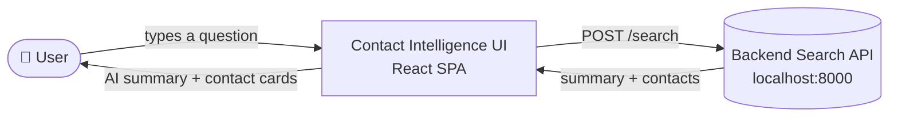

# Contact Intelligence UI: Documentation

Welcome. This folder explains what the **AI Contact Intelligence** frontend does, how it is built, and how data moves through it. If you are new to the project, read the pages in this order:

| # | Document | Read it to learn |
|---|----------|------------------|
| 1 | [Overview](#overview) (this page) | What the product is and the key ideas, in five minutes |
| 2 | [Architecture & High-Level Design](./ARCHITECTURE.md) | System context, layers, components, modules, design decisions |
| 3 | [Flows](./FLOWS.md) | Step-by-step flow, sequence, and state diagrams for every user interaction |
| 4 | [API & Data Contract](./API.md) | Backend endpoints, payloads, and the response-normalization rules |
| 5 | [Development Guide](./DEVELOPMENT.md) | Setup, scripts, conventions, styling, extending the app, troubleshooting, known limitations |

> **Diagrams:** every diagram is written in [Mermaid](https://mermaid.js.org/). Mermaid renders automatically on GitHub and GitLab. In VS Code, install the *Markdown Preview Mermaid Support* extension and open the Markdown preview.

---

## Overview

### What is it?

**AI Contact Intelligence** is a single-page web app for searching a network of contacts in **plain English**. Instead of filling in filters, the user types something like:

```text
Find frontend developers in San Francisco
```

The app sends that sentence to a backend AI search service. The backend replies with:

1. an **AI summary**, a short natural-language answer, and
2. a list of **matching contacts** (name, title, location, skills).

The UI shows the summary and then renders each contact as a card.

### What this repository contains, and what it does not

| In this repo (frontend) | Not in this repo (backend, external) |
|---|---|
| React + TypeScript UI | The search API at `http://localhost:8000` |
| HTTP client (Axios) | The AI/LLM that interprets queries and writes summaries |
| Response normalization (plain JSON **and** DynamoDB-style JSON) | The contact datastore (the response format suggests Amazon DynamoDB) |
| Styling, loading and error states | Authentication, if any |

### Key ideas at a glance



- **One page, one main action:** search. No routing and no login.
- **Thin client:** all the intelligence lives in the backend. The frontend sends the query, cleans up the response, and renders it.
- **Defensive data layer:** `src/api/contactApi.ts` accepts both `"name": "Avery"` and `"name": {"S": "Avery"}`, so the UI works whether or not the backend unwraps DynamoDB attribute values.
- **Summary-aware filtering:** if the AI summary mentions specific contacts by name, only those contacts are shown. If it mentions none, all returned contacts are shown. See [API.md › Summary-based filtering](./API.md#3-summary-based-filtering).

### Tech stack

| Concern | Technology | Version (package.json) |
|---|---|---|
| UI library | React | ^19.2 |
| Language | TypeScript (strict-ish, bundler mode) | ~6.0 |
| Build tool / dev server | Vite + `@vitejs/plugin-react` | ^8.0 |
| HTTP client | Axios | ^1.17 |
| Linting | ESLint 10 (flat config) + typescript-eslint + react-hooks + react-refresh | — |
| Styling | Plain CSS with custom properties (design tokens), BEM-style class names | — |
| Font | Inter (Google Fonts) | — |

### Quick start

```bash
npm install
npm run dev          # http://localhost:5173
# The backend must be running at http://localhost:8000
```

Full details are in the [Development Guide](./DEVELOPMENT.md).

### Glossary

| Term | Meaning |
|---|---|
| **Query** | The natural-language sentence the user types. |
| **Summary / AI summary** | The `response` string returned by the backend, written by the AI. |
| **Contact** | A person record: `contactId`, `name`, `title`, `location`, `skills[]`. |
| **Normalization** | Converting whatever shape the backend returns into the strict `Contact` / `SearchResponse` TypeScript types. |
| **DynamoDB attribute value** | AWS DynamoDB's typed JSON wrapper, e.g. `{"S": "text"}` for strings and `{"L": [...]}` for lists. |
| **SPA** | Single-page application: one HTML page whose content React updates in place. |
